# Hi! I’m Luisa

*and this is my dev portfolio*

 [projects](#projects) &nbsp;&nbsp;
 [my stack](#whats-in-my-stack) &nbsp;&nbsp;
 [sentinel hmi](#sentinel-hmi) &nbsp;&nbsp;
 [say hi](#lets-work-together)

 

## About me

I’m a **Systems & Computing Engineering** student at UTB who enjoys building **practical software** that solves real-world problems.

Whether designing **responsive frontend interfaces**, configuring **cloud infrastructure**, or connecting **telemetry data** from hardware devices, I thrive at the intersection of modern web development, cloud computing & data systems.

> ♡ &nbsp;software developer into **web, cloud, data & IoT** 
> ♡ &nbsp;i like turning **ideas** into things that **actually work** 
> ♡ &nbsp;always learning, always **shipping**

 

## what’s in my stack

<table>
  <tr>
    <th width="220">languages &nbsp;<code>fresh</code></th>
    <th width="220">front &amp; back &nbsp;<code>duo</code></th>
    <th width="220">cloud &amp; data &nbsp;<code>extra</code></th>
  </tr>
  <tr>
    <td valign="top">
       &nbsp;java 
       &nbsp;python 
       &nbsp;typescript 
       &nbsp;javascript
    </td>
    <td valign="top">
       &nbsp;react 
       &nbsp;vite 
       &nbsp;node.js 
       &nbsp;fastapi 
       &nbsp;django
    </td>
    <td valign="top">
       &nbsp;aws 
       &nbsp;docker 
       &nbsp;terraform 
       &nbsp;mysql 
       &nbsp;git
    </td>
  </tr>
</table>

 

## Sentinel HMI.

*my spotlight project.*

A **human-machine interface** for an **unmanned surface vehicle**. Engineered for **telemetry monitoring**, navigation control and real-time visualization.

`IoT` `React` `TypeScript` `Python`

- **real-time sensor data** — live telemetry & analytical dashboards
- **maps & visualization** — spatial mapping & trajectory tracking
- **vehicle control** — command interfaces for remote operation
- **IoT / cloud integration** — data pipelines to the backend

 

## Projects

*things I’ve built — from the idea to the code to the deploy*

<table>
  <tr>
    <td align="center" valign="top" width="33%">
      <code>● ● ● &nbsp;sentinel-hmi</code>  
        
      <b>Sentinel HMI</b> 
      Interface for monitoring unmanned surface vehicles · live maps, sensors &amp; telemetry  
      <code>IoT</code> <code>React</code> <code>TypeScript</code> <code>Python</code>  
      ★ featured system
    </td>
    <td align="center" valign="top" width="33%">
      <code>● ● ● &nbsp;telemetry-pipeline</code>  
        
      <b>Cloud Telemetry Pipeline</b> 
      Scalable infrastructure for receiving, processing &amp; storing sensor streams in real time  
      <code>AWS</code> <code>Docker</code> <code>FastAPI</code> <code>MySQL</code>  
      <a href="https://github.com/lutriana">GitHub ↗</a>
    </td>
    <td align="center" valign="top" width="33%">
      <code>● ● ● &nbsp;dev-dashboard</code>  
        
      <b>Developer Dashboard</b> 
      Web app with real-time state management, data visualization &amp; clean responsive UI  
      <code>Vite</code> <code>React</code> <code>Node.js</code> <code>Tailwind</code>  
      <a href="https://github.com/lutriana">GitHub ↗</a>
    </td>
  </tr>
</table>

 

## Let’s work together!

**contact me!**

 [codesluli@gmail.com](mailto:codesluli@gmail.com) &nbsp;·&nbsp;
 [/in/lutriana](https://www.linkedin.com/in/lutriana/) &nbsp;·&nbsp;
 [lutriana](https://github.com/lutriana) &nbsp;·&nbsp;
 [@luisatri4na](https://www.instagram.com/luisatri4na/)

 

 &nbsp;build · learn · improve · repeat&nbsp; 

[luisatriana.dev](https://luisatriana.dev/)

