 

 <a href="https://luisatriana.dev/">luisatriana.dev</a>
&nbsp;·&nbsp;
 <a href="https://www.linkedin.com/in/lutriana/">linkedin</a>
&nbsp;·&nbsp;
 <a href="https://www.instagram.com/luisatri4na/">instagram</a>
&nbsp;·&nbsp;
 <a href="mailto:codesluli@gmail.com">codesluli@gmail.com</a>

